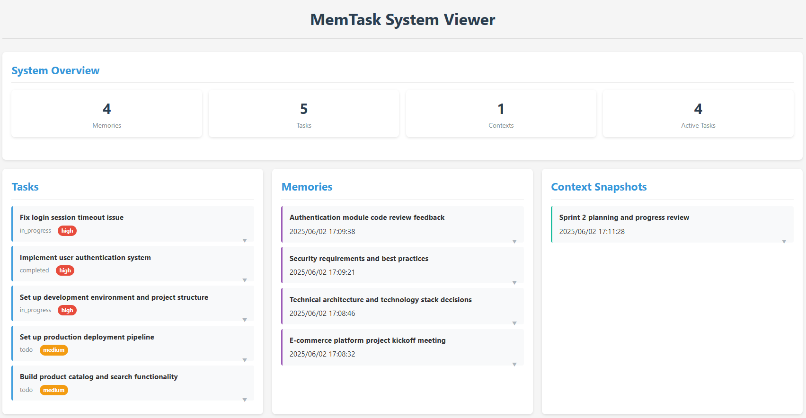
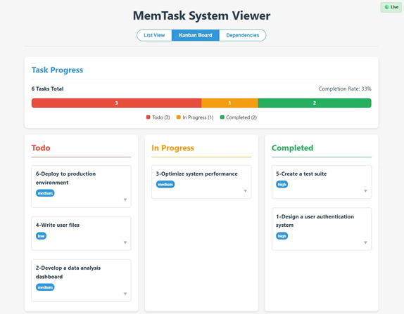
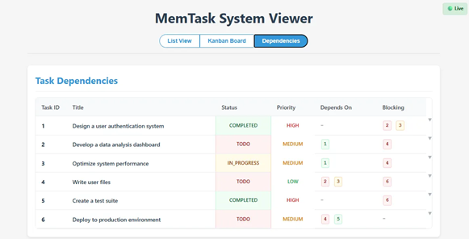
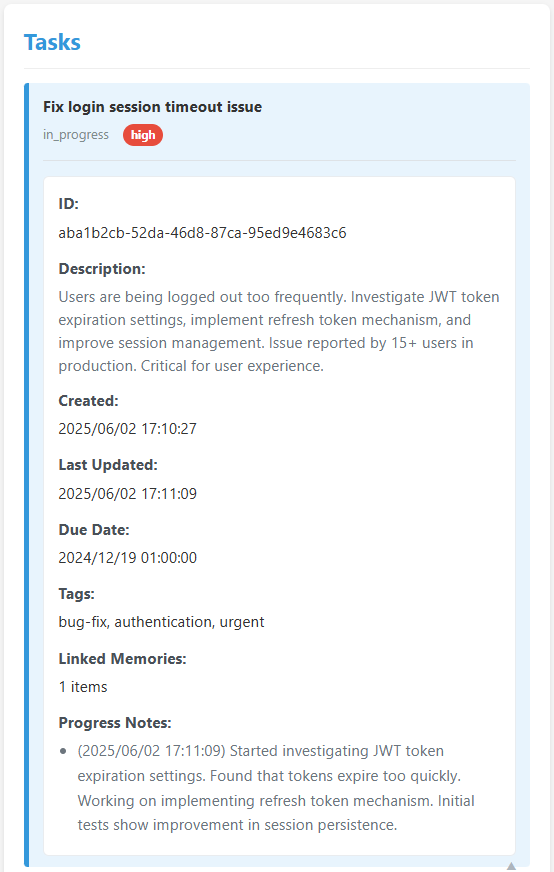
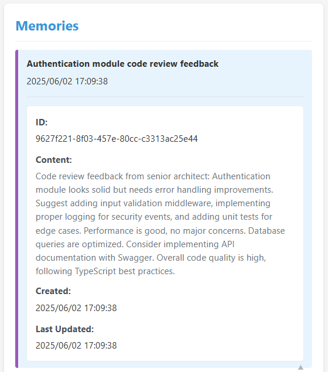
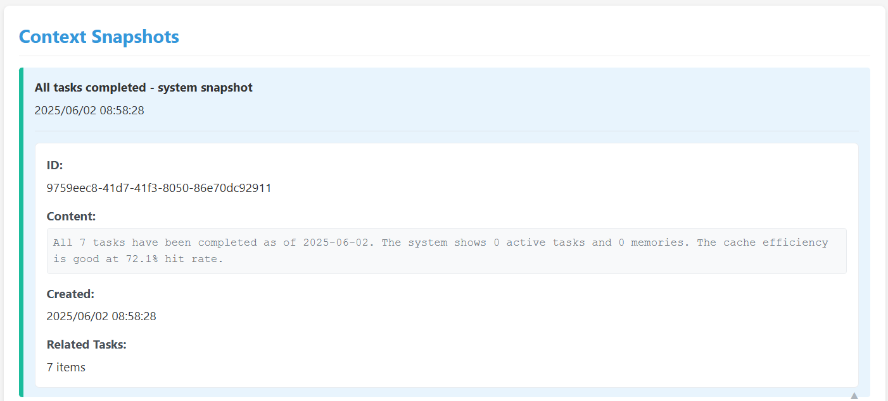

# MCP Memory & Task Management Server with Goal Tracking

## Overview

This is a complete implementation of a Model Context Protocol (MCP) server, providing goal management, task tracking, memory storage, and context management functionalities. The server implements a three-tier Goal -> Task -> Memory architecture with a modular design and local-first data storage strategy.

## Features

### Goal Management Module
- **Strategic Planning**: High-level goal creation and tracking with success criteria
- **Goal Hierarchy**: Goal -> Task -> Memory three-tier architecture
- **Status Management**: planning, active, completed, on_hold, cancelled states
- **Progress Tracking**: Automatic progress calculation based on linked tasks
- **Success Criteria**: Definable milestones and completion requirements
- **Target Dates**: Goal timeline management with overdue detection
- **Task Integration**: Seamless linking between goals and implementation tasks

### Memory & Context Management Module
- **Persistent Memory**: Local JSON file storage to ensure data privacy
- **Semantic Search**: Similarity calculation based on token overlap
- **Context Snapshots**: Automatically records and indexes context information
- **Tagging System**: Supports memory categorization and filtering

### Task & Progress Tracking Module
- **Task CRUD**: Full lifecycle management for tasks
- **Mandatory Goal Association**: All tasks must be linked to parent goals via required `goal_id`
- **Goal Validation**: Automatic validation ensures goal existence before task creation/updates
- **Status Tracking**: todo, in progress, completed, cancelled
- **Priority Management**: Three levels—low, medium, high
- **Progress Notes**: Timestamped progress update records
- **Task Dependencies**: Support for task dependency relationships with `depends_on` field
- **Dependency Validation**: Prevents circular dependencies and validates executable tasks
- **Goal-based Filtering**: Filter and list tasks by specific goals
- **Cascading Operations**: Goal deletion automatically handles related tasks
- **Semantic Linking**: Mechanism to associate tasks with memories

## Quick Start

### 1. Install Dependencies
```bash
npm install
```

### 2. Build & Run Server
```bash
# Development mode
npm run dev

# Production mode
npm run build
npm start
```

### 3. Test with MCP Inspector
```bash
npx @modelcontextprotocol/inspector ts-node src/index.ts
```

### 4. Add to MCP Client Configuration
```json
{
  "mcpServers": {
    "memory-task": {
      "command": "node",
      "args": ["/path/to/MemTask/dist/src/index.js"],
      "env": {
        "MCP_DATA_DIR": "/path/to/mcp_data"
      }
    }
  }
}
```

## Web Dashboard (Optional)

The server includes a web-based monitoring dashboard for managing memories and tasks through a browser interface.

### Start Dashboard
```bash
node web-viewer/server.js --data-dir ./mcp_data
# Access at http://localhost:8080
```

### Features
- **Goal Dashboard**: Strategic overview with progress tracking and success criteria
- **Task Management**: List view, Kanban board, and dependency visualization with Goal ID display
- **Enhanced Dependencies View**: Dedicated Goal ID column showing task-goal associations
- **Task Details**: Goal ID information displayed in expandable task details
- **Memory Browser**: Search and manage stored memories
- **Three-Tier Visualization**: Goal -> Task -> Memory relationship mapping
- **Real-time Updates**: WebSocket-based live data synchronization
- **Visual Indicators**: Color-coded status badges and progress tracking
- **Goal Progress**: Automatic progress calculation based on linked task completion
- **Orphaned Task Detection**: Clear visual indication of tasks without goal assignment

### Screenshots

#### Main Dashboard
  
*Main monitoring interface with system overview*

#### Kanban Board View
  
*Visual task management with drag-and-drop workflow*

#### Dependencies View  
  
*Task relationship visualization with status indicators*

#### Task Management Interface
   
*Detailed task management with expandable information*

#### Memory Management Interface
   
*Memory browser and search functionality*

#### Context Snapshots Interface
   
*Context snapshot management and browsing*

## ⚠️ Breaking Changes in v2.2.0

**IMPORTANT**: Version 2.2.0 introduces mandatory Goal-Task association and enhanced data integrity features.

### What's Changed in v2.2.0
- **BREAKING**: `create_task` now requires `goal_id` parameter
- **NEW**: Goal existence validation for task creation and updates
- **NEW**: Cascading cleanup when deleting goals (related tasks become orphaned)
- **ENHANCED**: Web UI displays Goal ID in task details and dependencies page
- **ENHANCED**: Task filtering by `goal_id` support in `list_tasks`
- **ENHANCED**: Goal ID reassignment via `update_task`

### Migration Required for v2.2.0
- **All new tasks must specify a valid `goal_id`**
- Existing tasks without `goal_id` remain as orphaned tasks
- Update task creation workflows to include goal association
- Review and reassign orphaned tasks to appropriate goals

## ⚠️ Breaking Changes in v2.1.0

**IMPORTANT**: Version 2.1.0 introduces the new Goal management system and expands the tool set to 17 operation-specific tools for comprehensive three-tier management.

### What's New in v2.1.0
- **NEW**: Goal management system with 6 dedicated tools
- **NEW**: Goal -> Task -> Memory three-tier architecture
- **ENHANCED**: Context snapshots now support `related_goals`
- **EXPANDED**: Total of 17 MCP tools (was 11 in v2.0.0)

### Tool Mapping (Complete)
| Category | v1.x Tool | v1.x Operation | v2.1 Tool |
|----------|-----------|----------------|-----------|
| **Memory** | `memory_tool` | `"create"` | `create_memory` |
| **Memory** | `memory_tool` | `"read"` | `read_memory` |
| **Memory** | `memory_tool` | `"search"` | `search_memories` |
| **Memory** | `memory_tool` | `"list"` | `list_memories` |
| **Memory** | `memory_tool` | `"delete"` | `delete_memory` |
| **Task** | `task_tool` | `"create"` | `create_task` |
| **Task** | `task_tool` | `"read"` | `read_task` |
| **Task** | `task_tool` | `"update"` | `update_task` |
| **Task** | `task_tool` | `"search"` | `search_tasks` |
| **Task** | `task_tool` | `"list"` | `list_tasks` |
| **Task** | `task_tool` | `"delete"` | `delete_task` |
| **Goal** | *New in v2.1* | - | `create_goal` |
| **Goal** | *New in v2.1* | - | `read_goal` |
| **Goal** | *New in v2.1* | - | `update_goal` |
| **Goal** | *New in v2.1* | - | `search_goals` |
| **Goal** | *New in v2.1* | - | `list_goals` |
| **Goal** | *New in v2.1* | - | `delete_goal` |

### Migration Required
If upgrading from v1.x, you **must** update all tool calls in your MCP client configuration. See the [MCP Usage Guide](#mcp-usage-guide) below for new tool usage examples.

## MCP Usage Guide

### Memory Management

#### Create Memory
```json
{
  "tool": "create_memory",
  "arguments": {
    "content": "Meeting notes: Discussed new product feature planning",
    "summary": "Product feature meeting notes",
    "tags": ["meeting", "product"],
    "context_id": "optional-context-id"
  }
}
```

#### Read Memory
```json
{
  "tool": "read_memory",
  "arguments": {
    "id": "memory-id-123"
  }
}
```

#### Search Memories
```json
{
  "tool": "search_memories",
  "arguments": {
    "query": "product feature",
    "limit": 5
  }
}
```

#### List Memories
```json
{
  "tool": "list_memories",
  "arguments": {
    "tags": ["meeting"]
  }
}
```

#### Delete Memory
```json
{
  "tool": "delete_memory",
  "arguments": {
    "id": "memory-id-123"
  }
}
```

### Goal Management

#### Create Goal
```json
{
  "tool": "create_goal",
  "arguments": {
    "title": "Launch MVP Product",
    "description": "Complete and launch the minimum viable product for our new platform",
    "priority": "high",
    "tags": ["product", "launch", "mvp"],
    "target_date": "2024-06-30T23:59:59Z",
    "success_criteria": [
      "Deploy to production environment",
      "Complete user acceptance testing",
      "Achieve 100 active beta users"
    ],
    "linked_tasks": ["task-1", "task-2"]
  }
}
```

#### Read Goal
```json
{
  "tool": "read_goal",
  "arguments": {
    "id": "goal-1"
  }
}
```

#### Update Goal
```json
{
  "tool": "update_goal",
  "arguments": {
    "id": "goal-1",
    "status": "active",
    "progress_note": "Development phase completed, moving to testing"
  }
}
```

#### Search Goals
```json
{
  "tool": "search_goals",
  "arguments": {
    "query": "product launch",
    "limit": 5
  }
}
```

#### List Goals
```json
{
  "tool": "list_goals",
  "arguments": {
    "status": "active",
    "priority": "high"
  }
}
```

#### Delete Goal
```json
{
  "tool": "delete_goal",
  "arguments": {
    "id": "goal-1"
  }
}
```

**Note**: Deleting a goal will automatically clear the `goal_id` field from all related tasks, making them orphaned tasks. The system will report how many tasks were affected by the deletion.

### Task Management

#### Create Task
```json
{
  "tool": "create_task",
  "arguments": {
    "title": "Complete product prototype",
    "description": "Build the product prototype based on meeting discussions",
    "goal_id": "goal-1",  // REQUIRED: Must specify valid goal ID
    "priority": "high",
    "tags": ["development", "prototype"],
    "due_date": "2024-12-31T23:59:59Z",
    "linked_memories": ["memory-id-1", "memory-id-2"],
    "depends_on": ["task-id-1", "task-id-2"]
  }
}
```

#### Read Task
```json
{
  "tool": "read_task",
  "arguments": {
    "id": "task-id-456"
  }
}
```

#### Update Task
```json
{
  "tool": "update_task",
  "arguments": {
    "id": "task-id-456",
    "status": "in_progress",
    "progress_note": "Initial design completed"
  }
}
```

#### Update Task Goal Assignment
```json
{
  "tool": "update_task",
  "arguments": {
    "id": "task-id-456",
    "goal_id": "goal-2"  // Reassign task to different goal
  }
}
```

#### Search Tasks
```json
{
  "tool": "search_tasks",
  "arguments": {
    "query": "prototype development",
    "limit": 10
  }
}
```

#### List Tasks
```json
{
  "tool": "list_tasks",
  "arguments": {
    "status": "in_progress",
    "priority": "high"
  }
}
```

#### List Tasks by Goal
```json
{
  "tool": "list_tasks",
  "arguments": {
    "goal_id": "goal-1"  // Filter tasks by specific goal
  }
}
```

#### Delete Task
```json
{
  "tool": "delete_task",
  "arguments": {
    "id": "task-id-456"
  }
}
```

### Context Management

#### Create Context Snapshot
```json
{
  "tool": "create_context_snapshot",
  "arguments": {
    "summary": "Product development discussion context",
    "content": "Detailed conversation content...",
    "related_memories": ["memory-id-1"],
    "related_tasks": ["task-id-1"],
    "related_goals": ["goal-id-1"]
  }
}
```

### System Overview

#### Get System Overview
```json
{
  "tool": "overview",
  "arguments": {}
}
```

## Data Formats

All data is stored as JSON files in the `mcp_data/` directory:
- **Goals**: Strategic objectives with success criteria, target dates, and linked tasks
- **Tasks**: Implementation units with goal association, dependencies, and memory links
- **Memories**: Knowledge base with content, tags, and contextual relationships
- **Context Snapshots**: Conversation summaries with related goals, tasks, and memories

### Directory Structure
```
mcp_data/
├── goals/          # Goal JSON files (goal-1.json, goal-2.json, ...)
├── tasks/          # Task JSON files (1.json, 2.json, ...)
├── memories/       # Memory JSON files (uuid.json)
└── contexts/       # Context snapshot JSON files (uuid.json)
```

### Three-Tier Architecture
```
Goal (Strategic Level)
 ├── linked_tasks: ["task-1", "task-2"]
 │
Task (Implementation Level)
 ├── goal_id: "goal-1" (REQUIRED)
 ├── linked_memories: ["memory-1", "memory-2"]
 │
Memory (Knowledge Level)
 └── Referenced by tasks for context and information
```

**Note**: Starting from v2.2.0, all tasks must have a `goal_id` to ensure proper Goal-Task association and maintain data integrity.

For detailed schema information, see the TypeScript interfaces in `src/types.ts`.

## Integration Recommendations

### Integrating with MCP Client (v2.1)
1. **Important**: Ensure you're using v2.1 compatible configuration
2. Add this server to the MCP client configuration using the new tool names
3. Use the stdio protocol for communication
4. Manage goals, tasks, and memories via the 17 operation-specific tools
5. Leverage the three-tier Goal -> Task -> Memory architecture for structured planning

### MCP Client Configuration Example
```json
{
  "mcpServers": {
    "memory-task": {
      "command": "node",
      "args": ["/path/to/MemTask/dist/src/index.js"],
      "env": {
        "MCP_DATA_DIR": "/path/to/mcp_data"
      }
    }
  }
}
```

### Version Compatibility Notes
- **v2.2**: Enhanced Goal-Task integration with mandatory association (current)
- **v2.1**: Uses 17 operation-specific tools with Goal management (deprecated)
- **v2.0**: Uses 11 operation-specific tools (deprecated)
- **v1.x**: Used unified `memory_tool` and `task_tool` (deprecated)
- **No backward compatibility** between major versions

### Goal-Driven Workflow Example
```json
// 1. Create a strategic goal
{
  "tool": "create_goal",
  "arguments": {
    "title": "Improve Customer Satisfaction",
    "description": "Increase customer satisfaction score to 95%",
    "target_date": "2024-12-31T23:59:59Z",
    "success_criteria": ["Achieve 95% CSAT score", "Reduce support tickets by 30%"]
  }
}

// 2. Create implementation tasks linked to the goal
{
  "tool": "create_task",
  "arguments": {
    "title": "Implement customer feedback system",
    "goal_id": "goal-1",
    "priority": "high"
  }
}

// 3. Track progress and update goal status
{
  "tool": "update_goal",
  "arguments": {
    "id": "goal-1",
    "status": "active",
    "progress_note": "Feedback system deployed, monitoring CSAT metrics"
  }
}
```
